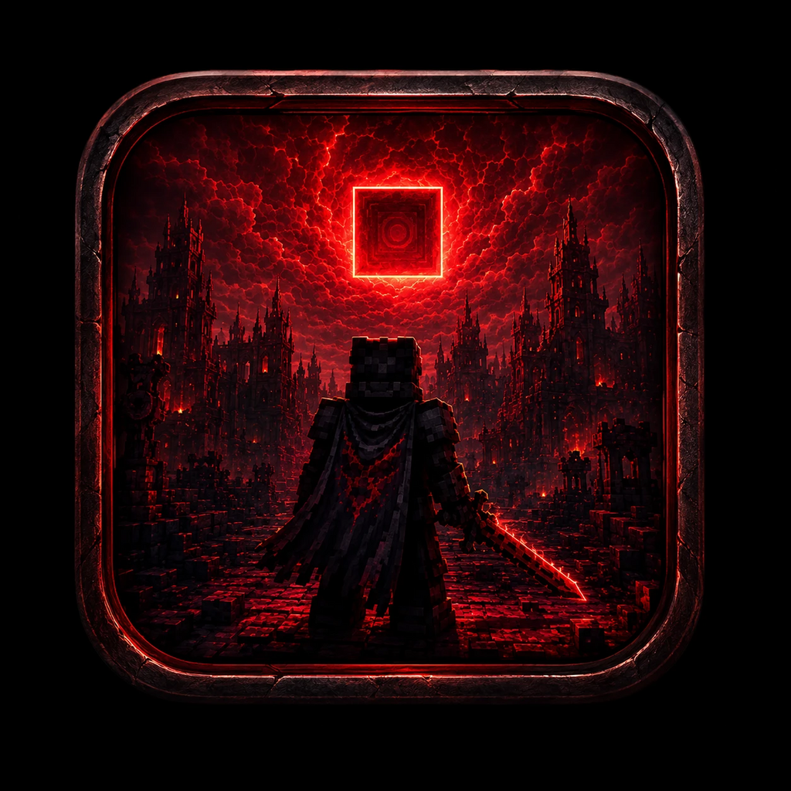
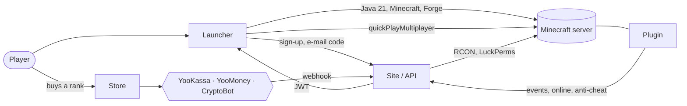

<div align="center">



# NATUX WORLD

### A complete Minecraft server business in one repository: launcher, storefront, and server plugin

**One `.exe`, one button — the player is on the server in under a minute.**<br/>
They buy a rank, permissions are granted automatically. No admin in the loop.

<br/>

<a href="README.md"></a>
<a href="README.en.md"></a>

<br/><br/>


<br/>


</div>

---

> ### 💼 The whole project is for sale
>
> Both repositories, the domain, the infrastructure, and every document transfer to a single owner.
> The straight-talking checklist of credentials, production checks, and known limits lives in **[docs/BUYER_HANDOVER.md](docs/BUYER_HANDOVER.md)**.

---

## 🎯 What this actually is

The typical Minecraft project runs on a 2010-era forum, sells ranks over direct messages, and tells players to "download the archive and unzip it into `.minecraft`." Players drop off at every step, and the owner hands out permissions by hand.

**NATUX WORLD deletes that entire chain.**

<table>
<tr>
<td width="33%" valign="top">

### 🚀 Launcher
Windows and macOS. Installs Java 21, Minecraft, and Forge 1.21.1 on its own, then joins the server in **one click**. Updates over the air, cryptographically signed.

</td>
<td width="33%" valign="top">

### 🌐 Site + API
Next.js 14 on PostgreSQL. Accounts with 2FA, a **self-hosted Yggdrasil authserver**, a rank store, live payments, and an admin panel with an RCON console.

</td>
<td width="33%" valign="top">

### 🧩 Plugin
Paper 1.21. Streams in-game events, ships an anti-cheat baseline, and feeds the site's leaderboard.

</td>
</tr>
</table>

The three parts were built as **one system**: the site account is the launcher login, which is the in-game name, which is the store customer, which is the leaderboard row. Nothing has to be wired together by hand.

---

## 📊 What's inside, by the numbers

<div align="center">

| | | | |
|:--|--:|:--|--:|
| **Lines of code** | `27,704` | **Automated tests** | `273` ✅ |
| **API endpoints** | `65` | **Test files** | `58` |
| **React components** | `59` | **Database models** | `15` |
| **Launcher services** | `19` | **Prisma migrations** | `21` |

</div>

> Verified on the current commit: `npm test` gives **106/106** in the launcher and **167/167** on the site — both suites green in seven seconds.
> These aren't checkbox tests: `DownloadService` spins up a real HTTP server and asserts that a SHA-1 mismatch is rejected.

---

## ⚡ How it works



The full player journey — from download to granted rank — **requires zero admin actions**.

---

## 🚀 The launcher

| | |
|---|---|
| 🎮 **One button** | Downloads Minecraft + Forge 1.21.1, installs it, and joins the server directly via `quickPlayMultiplayer` |
| ☕ **Java handled** | Finds Java 21+ on the machine, or downloads and installs it when there is none |
| 🔥 **Headless Forge** | Installs without a single dialog, validates the zip, and self-heals a corrupted download |
| 👤 **Accounts** | Sign up → e-mail code → log in. The account name *is* the in-game name; impersonation is impossible |
| ⚙️ **Settings** | Memory (bounded by actual system RAM), Java selection, resolution, fullscreen, JVM args, auto-start |
| 📜 **Live logs** | Batched install and game log streaming, so the UI never freezes under a heavy download |
| 🩺 **Diagnostics** | One-click environment check plus automatic crash reporting |
| ⏱️ **Playtime** | Hour tracking that handles a hard crash correctly instead of counting idle time |
| 💬 **Discord Rich Presence** | "Playing on the server" status — enabled with a single ID in the config |
| 🔄 **Signed updates** | Before any download: **Ed25519 manifest signature**, version, filename, and SHA-512 are all verified |

<details>
<summary><b>Design: Dark Cyber Fantasy</b></summary>

<br/>

Glass surfaces, premium shadows, red ambient glow. Buttons use Framer Motion spring physics with a glow; the **PLAY** button pulses on a red gradient under a shimmer overlay.

| Token | Color |
|-------|-------|
| Background | `#070707` |
| Card | `#0F1117` · `#141821` |
| Accent | `#FF2B4F` · glow `#FF0037` |
| Discord · Success · Warning | `#5865F2` · `#00FF7F` · `#FF8A00` |

</details>

---

## 🌐 Site, API, and admin panel

| | |
|---|---|
| 🛒 **Rank store** | 7 ranks × 3 durations (30 days / 90 days / permanent), with discount coupons |
| 💳 **Three processors** | YooKassa (cards, SBP), YooMoney, CryptoBot (crypto). `multi` mode runs them side by side |
| ✅ **Auto-fulfillment** | RCON → LuckPerms the moment payment clears, 3 retries, idempotent against double delivery |
| 🔑 **Yggdrasil authserver** | Your own Minecraft auth instead of Mojang: `authenticate`, `refresh`, `validate`, `invalidate`, `join`, `hasJoined` |
| 🔐 **Serious 2FA** | TOTP with QR enrollment, e-mail codes, backup codes, and app passwords for integrations |
| 🛡️ **Admin panel** | Orders, refunds, delivery retries, users, bans, whitelist, RCON console, coupons, stats, audit log, crash reports |
| 🏆 **Leaderboard** | Player rankings built from live plugin data |
| 🟢 **Server status** | Online state, player count, and version on the front page in real time |
| 🎨 **3D scenes** | Three.js world map and winners' podium |
| 🐳 **Deployment** | Docker + Compose + nginx + `vps-setup.sh` — bare VPS to production, documented |

---

## 🧩 Server plugin

Paper API `1.21`, Java, shaded into a single `.jar` by Maven.

- **Anti-cheat baseline** — `AntiCheatListener` and `ViolationTracker` accumulate violations per player.
- **Event buffer** — `EventBuffer` survives network stalls and flushes the remainder cleanly on server shutdown.
- **API delivery** — `ApiSender` authenticates with `GAME_API_KEY`, retries, and refuses to drop data.

---

## 🔐 Security

> Per the internal audit (`SECURITY_AUDIT.md`, re-checked 2026-07-12): **0 critical findings**, grade **B+**, and `npm audit --omit=dev` reports zero advisories.

| Layer | What's in place |
|---|---|
| **Electron** | `contextIsolation` + `sandbox` + CSP + a `will-navigate` guard, with no remote content whatsoever |
| **Downloads** | Pinned SHA-1 for Forge, artifact hash verification, zip-slip protection, and **no HTTPS → HTTP downgrade** on redirects |
| **Tokens** | Held in the OS keychain via `safeStorage`; memory-only when unavailable, with legacy plaintext wiped |
| **Updates** | Ed25519-signed manifest. The private key lives **only** in a GitHub Secret; the app ships the public key alone |
| **Passwords** | bcrypt hashing; verification codes stored as SHA-256, TOTP secrets encrypted at rest |
| **Sessions** | `tokenVersion` for instant global revocation, plus rate limiting and lockout on login |
| **Admin** | Mandatory TOTP, IP allowlist, and an audit log entry for every action |

The project has been through **three independent audits**, and the reports sit in the repo in the open — unresolved items included: [`docs/AUDIT-2026-06-11.md`](docs/AUDIT-2026-06-11.md), [`docs/ADVERSARIAL_CODE_REVIEW_2026-08-20.md`](docs/ADVERSARIAL_CODE_REVIEW_2026-08-20.md), [`docs/CODE-REVIEW-FULL-2026-09-07.md`](docs/CODE-REVIEW-FULL-2026-09-07.md).

---

## 🏷️ Rebranding it as your own server

Nothing is **hard-wired** to `vibestudy.ru`. Identity lives in exactly two places:

```ts
// brand.config.ts — launcher, build-time
export const BRAND = {
  name: 'NATUX WORLD',
  siteOrigin: 'https://vibestudy.ru',
  serverHost: 'mc.vibestudy.ru',
  minecraftVersionLabel: '1.21.1 Forge',
  discordClientId: '',
};
```

```bash
# site — environment variables
NEXT_PUBLIC_SERVER_NAME=MY SERVER
NEXT_PUBLIC_SITE_DOMAIN=example.com
NEXT_PUBLIC_SERVER_IP=mc.example.com
```

Change the values, run a build, and both the launcher and the site carry your brand.

---

## ⚙️ Quick start

```bash
npm ci
npm run dev          # Vite + Electron with hot reload

cd website
npm ci
npm run dev          # Next.js on localhost:3000
```

| Script | What it does |
|--------|-------------|
| `npm run dev` | Development with hot reload |
| `npm run build` | Full build and installers (`electron-builder`) |
| `npm run build:web` | Renderer only |
| `npm test` | Vitest — 106 launcher tests |
| `npm run typecheck` | `tsc -b --noEmit` |
| `npm run lint` | ESLint |

<details>
<summary><b>Repository layout</b></summary>

```
NatuxWorld/
├── electron/                   # Launcher main process
│   ├── main.ts                 # Window, auto-update, Electron fuses
│   ├── preload.ts              # Context-isolated bridge → window.natux
│   ├── ipc/                    # Channels and handlers
│   └── services/               # 19 services: Launcher, Forge, Java, Minecraft,
│                               # Account, Update, UpdateTrust, Playtime, Discord…
├── src/                        # Renderer: React 19 + Zustand + Tailwind
│   ├── components/auth/        # LoginScreen, RegisterScreen, VerifyEmail, AuthGate
│   ├── store/ · pages/ · hooks/ · lib/
│   └── services/electron-bridge.ts   # Web fallback: the UI runs without Electron
├── website/                    # Next.js 14 + Prisma 7 + PostgreSQL
│   ├── src/app/api/            # 65 routes: auth, yggdrasil, payments, admin…
│   ├── src/lib/                # 32 modules: rcon, fulfillment, totp, coupons…
│   ├── prisma/                 # 15 models, 21 migrations
│   ├── natux-plugin/           # Paper plugin (Java)
│   └── Dockerfile · nginx.conf · vps-setup.sh
└── docs/                       # Audits, guides, feature specs and plans
```

</details>

---

## 📦 Releases and CI

A release is driven by **one line in `package.json`** — you never tag by hand.

```bash
npm version 1.9.16 --no-git-tag-version
git commit -am "release: v1.9.16" && git push
```

GitHub Actions takes it from there:

1. Runs `typecheck` and the test suites — **red tests stop the release**.
2. Builds `.exe` (NSIS and portable) plus `.dmg`, and publishes them to a GitHub Release.
3. Signs the update manifest with `UPDATE_SIGNING_PRIVATE_KEY`.
4. **Only after a successful publish** does it create the `vX.Y.Z` tag.

> Step 4 isn't a detail: it fixes a real v1.8.0 bug where a failed publish still left the tag behind, so every retry decided the version had already shipped.

---

## 📥 Installing it as a player

Windows and macOS, getting past SmartScreen and Gatekeeper, verifying checksums — **[docs/INSTALL.md](docs/INSTALL.md)**.

---

## 🤝 What the sale includes

- ✅ Both repositories with full history and the audit reports left in the open
- ✅ The Windows and macOS launcher plus a working release pipeline
- ✅ Site, API, admin panel, database schema, and migrations
- ✅ The server plugin with sources
- ✅ Docker configuration and a bare-VPS deployment guide
- ✅ Documentation: handover, install, deploy, server migration, feature specs

### Straight talk about what's missing

Nothing is buried — the limits are listed in [docs/BUYER_HANDOVER.md](docs/BUYER_HANDOVER.md):

- The Windows installer has **no Authenticode certificate**, so SmartScreen shows a warning. Ed25519 protects the update channel, not the publisher name.
- The macOS `.dmg` is **not notarized**, so the first launch needs `xattr -cr`.
- Both are closed by buying certificates; the code is already built for it.

---

<div align="center">

### Want to see it live?

**[mc.vibestudy.ru](https://mc.vibestudy.ru)** · **[Download the launcher](https://github.com/Alex-dev-sys/NatuxWorld/releases)** · **[Handover terms](docs/BUYER_HANDOVER.md)**

<sub>NATUX WORLD · 27,704 lines, 273 green tests, three audits, and nothing hidden in the closet</sub>

</div>
