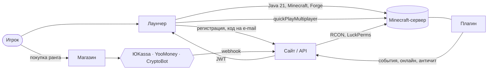

<div align="center">


# NATUX WORLD

### Готовая экосистема Minecraft-сервера: лаунчер, сайт с донат-магазином и серверный плагин

**Игрок скачивает один `.exe`, жмёт одну кнопку — и через минуту он на сервере.**<br/>
Покупает ранг — привилегии выдаются сами, без администратора.

<br/>

<a href="README.md"></a>
<a href="README.en.md"></a>

<br/><br/>


<br/>


</div>

---

> ### 💼 Проект продаётся целиком
>
> Два репозитория, домен, инфраструктура и вся документация передаются одному владельцу.
> Честный чек-лист доступов, production-проверок и ограничений — **[docs/BUYER_HANDOVER.md](docs/BUYER_HANDOVER.md)**.

---

## 🎯 Что это на самом деле

Обычный Minecraft-проект — это форум на движке 2010 года, донат через личку админа и «скачай архив, распакуй в `.minecraft`». Игроки отваливаются на каждом шаге, а владелец руками выдаёт привилегии.

**NATUX WORLD убирает всю эту цепочку.**

<table>
<tr>
<td width="33%" valign="top">

### 🚀 Лаунчер
Windows и macOS. Сам ставит Java 21, Minecraft и Forge 1.21.1, подключает к серверу **одним кликом**. Обновляется по воздуху с криптографической подписью.

</td>
<td width="33%" valign="top">

### 🌐 Сайт + API
Next.js 14 и PostgreSQL. Аккаунты с 2FA, **собственный Yggdrasil-authserver**, донат-магазин, приём платежей, админ-панель с RCON-консолью.

</td>
<td width="33%" valign="top">

### 🧩 Плагин
Paper 1.21. Собирает игровые события, античит-базлайн, отдаёт статистику в лидерборд сайта.

</td>
</tr>
</table>

Три части написаны как **одна система**: аккаунт с сайта — это логин в лаунчере, он же ник в игре, он же покупатель в магазине, он же строка в лидерборде. Ничего не нужно связывать вручную.

---

## 📊 Что внутри — в цифрах

<div align="center">

| | | | |
|:--|--:|:--|--:|
| **Строк кода** | `27 704` | **Автотестов** | `273` ✅ |
| **API-эндпоинтов** | `65` | **Тестовых файлов** | `58` |
| **React-компонентов** | `59` | **Моделей БД** | `15` |
| **Сервисов лаунчера** | `19` | **Миграций Prisma** | `21` |

</div>

> Таблица выше — исторический снимок проекта до завершения переноса. Актуальную проверку выполняйте командами ниже: React/Vitest и Rust проверяются отдельно, сайт имеет свою тестовую сюиту. Live-подключение Minecraft пользователь пока отложил; unit и packaged smoke не подтверждают вход на сервер.

---

## ⚡ Как это работает



Полный путь игрока — от скачивания до выданного ранга — **не требует ни одного действия администратора**.

---

## 🚀 Лаунчер

| | |
|---|---|
| 🎮 **Одна кнопка** | Качает Minecraft + Forge 1.21.1, ставит и сразу коннектит на сервер через `quickPlayMultiplayer` |
| ☕ **Java из коробки** | Ищет Java 21+ в системе, при отсутствии — скачивает и ставит сам |
| 🔥 **Headless Forge** | Установка без единого диалога, проверка целостности zip и авто-восстановление при повреждении |
| 👤 **Аккаунты** | Регистрация → код на e-mail → вход. Ник аккаунта = ник в игре, подмена невозможна |
| ⚙️ **Настройки** | Память (с привязкой к ОЗУ системы), выбор Java, разрешение, fullscreen, JVM-аргументы, автозапуск |
| 📜 **Логи в реальном времени** | Поток установки и игры с батчингом — UI не фризит даже на тяжёлой загрузке |
| 🩺 **Диагностика** | Встроенная проверка окружения одной кнопкой и автоотправка crash-репортов |
| ⏱️ **Игровое время** | Учёт наигранных часов с корректной обработкой аварийного выхода |
| 💬 **Discord Rich Presence** | Статус «играет на сервере» — включается одним ID в конфиге |
| 🔄 **Подписанные обновления** | Проверяются control-feed, подпись Tauri-пакета, версия, имя и хеши. Windows NSIS обновляется автоматически; macOS и Windows Portable — вручную |

<details>
<summary><b>Дизайн: Dark Cyber Fantasy</b></summary>

<br/>

Стекло, премиум-тени, красное амбиентное свечение. Кнопки на Framer Motion spring + glow; кнопка **ИГРАТЬ** пульсирует красным градиентом с shimmer-оверлеем.

| Токен | Цвет |
|-------|------|
| Фон | `#070707` |
| Карточка | `#0F1117` · `#141821` |
| Акцент | `#FF2B4F` · свечение `#FF0037` |
| Discord · Success · Warning | `#5865F2` · `#00FF7F` · `#FF8A00` |

</details>

---

## 🌐 Сайт, API и админ-панель

| | |
|---|---|
| 🛒 **Донат-магазин** | 7 рангов × 3 срока (30 дней / 90 дней / навсегда), промокоды со скидками |
| 💳 **Три платёжки** | ЮKassa (карты, СБП), YooMoney, CryptoBot (крипта). Режим `multi` — все сразу |
| ✅ **Автовыдача** | RCON → LuckPerms сразу после оплаты, 3 попытки, идемпотентность против двойной выдачи |
| 🔑 **Yggdrasil authserver** | Собственный auth для Minecraft вместо Mojang: `authenticate`, `refresh`, `validate`, `invalidate`, `join`, `hasJoined` |
| 🔐 **2FA всерьёз** | TOTP с QR-кодом, e-mail-коды, резервные коды, app-passwords для интеграций |
| 🛡️ **Админ-панель** | Заказы, возвраты, повтор выдачи, пользователи, баны, whitelist, RCON-консоль, промокоды, статистика, audit log, crash-репорты |
| 🏆 **Лидерборд** | Рейтинг игроков по данным плагина |
| 🟢 **Статус сервера** | Онлайн, игроки, версия — на главной в реальном времени |
| 🎨 **3D-сцены** | Three.js: карта мира и пьедестал победителей |
| 🐳 **Деплой** | Docker + Compose + nginx + [`website/vps-setup.sh`](website/vps-setup.sh) — с нуля до production по инструкции |

---

## 🧩 Серверный плагин

Paper API `1.21`, Java, Maven-shade в один `.jar`.

- **Античит-базлайн** — `AntiCheatListener` и `ViolationTracker` с накоплением нарушений.
- **Буфер событий** — `EventBuffer` переживает лаги сети и корректно дописывает остаток при выключении сервера.
- **Отправка в API** — `ApiSender` с ключом `GAME_API_KEY`, ретраями и защитой от потери данных.

---

## 🔐 Безопасность

> По внутреннему аудиту ([`SECURITY_AUDIT.md`](SECURITY_AUDIT.md), повторная проверка 2026-07-12): **0 критических**, оценка **B+**, `npm audit --omit=dev` — 0 уязвимостей.

| Слой | Что сделано |
|---|---|
| **Tauri/Rust** | Bundled React, CSP и capabilities; команды Rust проверяют ввод, нативные службы работают без Node.js sidecar |
| **Загрузки** | Pinned SHA-1 для Forge, проверка хешей артефактов, защита от zip-slip, **запрет downgrade HTTPS → HTTP** на редиректах |
| **Токены** | В системном хранилище через Rust keyring; при недоступности — только в памяти с сообщением UI. После перехода нужен повторный вход |
| **Обновления** | Ed25519-подпись манифеста, приватный ключ **только** в GitHub Secret, в приложение вшит лишь публичный |
| **Пароли** | bcrypt; коды подтверждения хранятся как SHA-256, TOTP-секреты шифруются на диске |
| **Сессии** | `tokenVersion` для мгновенного глобального отзыва, rate-limit и lockout на логине |
| **Админка** | Обязательный TOTP, whitelist по IP, audit log каждого действия |

История аудитов и ревью кода хранится открыто, вместе с нерешёнными пунктами: [`AUDIT-2026-06-11`](docs/AUDIT-2026-06-11.md), [`ADVERSARIAL_CODE_REVIEW-2026-08-20`](docs/ADVERSARIAL_CODE_REVIEW_2026-08-20.md), [`CODE-REVIEW-2026-09-06`](docs/CODE-REVIEW-2026-09-06.md) и [`CODE-REVIEW-FULL-2026-09-07`](docs/CODE-REVIEW-FULL-2026-09-07.md).

---

## 🏷️ Ребрендинг под свой сервер

Проект **не приколочен** к `vibestudy.ru`. Идентичность вынесена в две точки:

```ts
// config/launcher-brand.json — общий источник для Rust и TypeScript
// brand.config.ts — TypeScript-фасад, build-time
{
  "name": "NATUX WORLD",
  "siteOrigin": "https://vibestudy.ru",
  "serverHost": "mc.vibestudy.ru",
  "minecraftVersionLabel": "1.21.1 Forge",
  "discordClientId": ""
}
```

```bash
# сайт — переменные окружения
NEXT_PUBLIC_SERVER_NAME=МОЙ СЕРВЕР
NEXT_PUBLIC_SITE_DOMAIN=example.ru
NEXT_PUBLIC_SERVER_IP=mc.example.ru
```

Меняете значения, собираете — получаете лаунчер и сайт под своим брендом.

---

## ⚙️ Быстрый старт

```bash
npm ci
npm run dev          # Tauri/Rust + Vite с hot reload

cd website
npm ci
npm run dev          # Next.js на localhost:3000
```

| Скрипт | Что делает |
|--------|-----------|
| `npm run dev` | Разработка с hot reload |
| `npm run build` | Tauri/Rust и установщик для текущей ОС |
| `npm run build:web` | React-рендерер Tauri |
| `npm test` | Vitest — UI, bridge и валидаторы |
| `npm run typecheck` | TypeScript основного Tauri frontend |
| `npm run lint` | ESLint |
| `npm run test:packaged` | Tauri executable smoke с отдельным профилем |
| `npm run build:portable` | Windows x64 Portable ZIP |
| `npm run test:portable` | Запуск portable и перенос его профиля между каталогами |
| `npm run electron:install` | Зависимости необязательного Electron rollback-пакета |
| `npm run electron:build` | Отдельная сборка Electron для отката |

Для desktop-сборки нужны Rust toolchain, C++ build tools и Java JDK для lock-agent; на Windows — WebView2. Подробные проверки и release gates: [docs/BUYER_HANDOVER.md](docs/BUYER_HANDOVER.md). Portable хранит профиль и WebView cache рядом с executable; автообновление и автозапуск для него не поддерживаются. После распаковки запускайте `Start NATUX WORLD.cmd`: если WebView2 отсутствует, helper предлагает установить его и проверяет Authenticode-подпись Microsoft перед запуском installer. Установка runtime на чистой Windows пока не проверена.

<details>
<summary><b>Структура репозитория</b></summary>

```
NatuxWorld/
├── electron/                   # Необязательный rollback-пакет со своими зависимостями
│   ├── main.ts                 # Окно, авто-апдейт, Electron fuses
│   ├── preload.ts              # Context-isolated мост → window.natux
│   ├── ipc/                    # Каналы и хендлеры
│   └── services/               # 19 сервисов: Launcher, Forge, Java, Minecraft,
│                               # Account, Update, UpdateTrust, Playtime, Discord…
├── src/                        # Renderer: React 19 + Zustand + Tailwind
│   ├── components/auth/        # LoginScreen, RegisterScreen, VerifyEmail, AuthGate
│   ├── store/ · pages/ · hooks/ · lib/
│   ├── services/native-bridge.ts     # Native-фасад и Tauri bridge
│   ├── native/                 # Основное Tauri-приложение и Rust-службы
│   ├── profile-lock-core/      # Отдельная Rust-библиотека
│   └── lock-agent/             # Java-агент и его тесты
├── tests/
│   ├── e2e/                    # Упаковочные и установочные harness-ы
│   └── scripts/                # Контракты tooling и release-скриптов
├── scripts/                    # Сборка, проверка и вспомогательные инструменты
├── website/                    # Next.js 14 + Prisma 7 + PostgreSQL
│   ├── src/app/api/            # 65 роутов: auth, yggdrasil, payments, admin…
│   ├── src/lib/                # 32 модуля: rcon, fulfillment, totp, coupons…
│   ├── prisma/                 # 15 моделей, 21 миграция
│   ├── natux-plugin/           # Paper-плагин (Java)
│   └── Dockerfile · nginx.conf · scripts/vps-setup.sh
└── docs/
    ├── BUYER_HANDOVER.md       # Передача проекта
    ├── INSTALL.md              # Установка лаунчера игроками
    ├── operations/             # Развёртывание и загрузки лаунчера
    ├── plans/                  # Миграции и планы
    ├── reviews/                # Аудиты и code review
    ├── architecture/           # Экспорты архитектурной схемы
    ├── references/             # Справочные материалы
    └── superpowers/            # Исторические планы и спецификации
```

</details>

---

## 📦 Релизы и CI

Версия исходников — **1.10.0**. `npm run dev`, `build`, `build:web` и `test:packaged` используют Tauri. Electron сохранён как необязательный rollback-пакет, который не требуется для установки основных зависимостей.

Build workflow проверяет Windows и macOS Intel/Apple Silicon. Проверяемая политика `config/launcher-release-policy.json` включает Tauri, миграцию и rollout 100% по умолчанию; отсутствующие repository variables не переключают сборку обратно на Electron. `TAURI_UPDATES_ENABLED`, `TAURI_MIGRATION_ENABLED` и `TAURI_ROLLOUT_PCT` остаются явными операторскими overrides. Для публикации требуются ключи `TAURI_SIGNING_PRIVATE_KEY` / `UPDATE_SIGNING_PRIVATE_KEY` и успешная приёмка. CI проверяет конечные NSIS, portable ZIP и macOS DMG перед публикацией, формирует подписи, native executable hash, checksums и channel-feed. Source policy не означает, что публикация уже выполнена.

Последний подтверждённый GitHub Build от **13 октября 2026** на `c70ec65` (1.9.15) прошёл Windows/macOS validation; updater-публикация была пропущена. Новые изменения 1.10.0 ещё требуют собственного CI и релиза. Подписанное обновление с предыдущей версии, чистая Windows без WebView2 и live Minecraft остаются отдельными приёмочными проверками. Установленная NATUX WORLD 1.9.15 в обычной Windows-учётной записи блокирует новую локальную NSIS-приёмку: её нужно выполнять в чистой изолированной среде/CI. Порядок выпуска: [docs/BUYER_HANDOVER.md](docs/BUYER_HANDOVER.md).

---

## 📥 Установка для игроков

Windows и macOS, обход SmartScreen и Gatekeeper, проверка контрольных сумм — **[docs/INSTALL.md](docs/INSTALL.md)**.

## 📚 Документация

- **Передача проекта:** [docs/BUYER_HANDOVER.md](docs/BUYER_HANDOVER.md)
- **Эксплуатация:** [инструкция HERMES](docs/HERMES_DEPLOY.md), [загрузка лаунчера на сайт](docs/LAUNCHER_DOWNLOADS_ON_SITE.md)
- **Планы:** [миграция лаунчера на Tauri](docs/plans/TAURI_MIGRATION_PLAN.md), [миграция сервера](docs/SERVER_MIGRATION_TZ.md)
- **Аудиты и ревью:** [docs/](docs/)

---

## 🤝 Что входит в передачу

- ✅ Оба репозитория с полной историей и открытыми отчётами аудитов
- ✅ Лаунчер под Windows и macOS плюс настроенный пайплайн релизов
- ✅ Сайт, API, админ-панель, схема БД и миграции
- ✅ Серверный плагин с исходниками
- ✅ Docker-конфигурация и инструкция деплоя на VPS с нуля
- ✅ Документация: передача, установка, деплой, миграция сервера, спеки фич

### Честно о том, чего пока нет

Ограничения не спрятаны — они перечислены в [docs/BUYER_HANDOVER.md](docs/BUYER_HANDOVER.md):

- Установщик Windows **без Authenticode** — SmartScreen показывает предупреждение. Ed25519 защищает канал обновления, но не имя издателя.
- macOS `.dmg` **без notarization** — Gatekeeper может потребовать ручное разрешение приложения в Privacy & Security.
- Подпись ОС необязательна для принятого режима выпуска; криптографические подписи updater и control-feed обязательны. Новый Tauri-релиз ещё не опубликован.

---

<div align="center">

### Хотите посмотреть вживую?

**[mc.vibestudy.ru](https://mc.vibestudy.ru)** · **[Скачать лаунчер](https://github.com/Alex-dev-sys/NatuxWorld/releases)** · **[Условия передачи](docs/BUYER_HANDOVER.md)**

<sub>NATUX WORLD · Tauri 2 + Rust · React · Next.js · Paper</sub>

</div>
